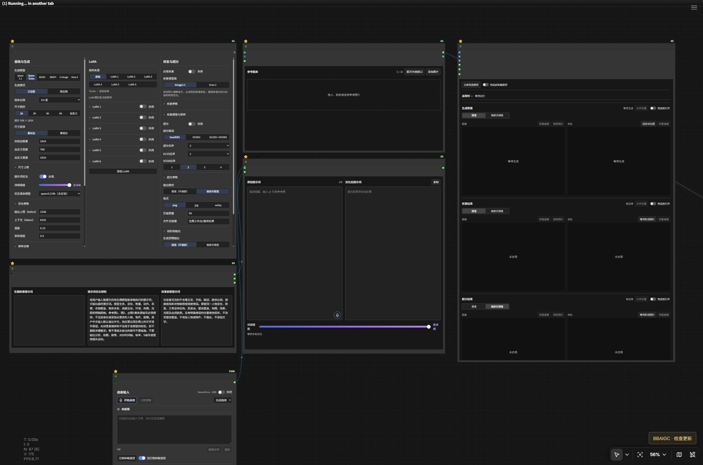

<div align="center">

# BBAIGC 生图工作台

### 像聊天一样表达需求，完成多图编辑与一键生图


[快速安装](#智能体开箱即用--复制即装) · [模型下载](MODELS.md) · [安装提示词](AGENT_INSTALL.md) · [版本清单](release.json)

</div>

**放入参考图，用文字或语音说清楚想法，把多图参考、提示词优化、生成、修复和超分交给一套工作台串起来。** 原文与优化结果并排查看，模型路线、LoRA 和输出设置集中操作，减少反复切换工作流、连接节点和手动整理提示词。

> [!TIP]
> **从表达需求到完成图片：语音／文字 → 参考图绑定 → 按目标模型优化提示词 → 生图／编辑 → 按需修复与超分。**
>
> 本地模型路线使用本地模型推理；需要云端图像服务时，可在同一工作台切换 BBAPI。

## 最值得用它的四个理由

| 核心特点 | 使用时的好处 |
|---|---|
| **复杂多图需求，图片身份跟着走** | 拖入或粘贴多张图，在输入框引用缩略图；删除后自动重排编号，已绑定对象保持对应，缺失引用就地红标 |
| **说一句话，提示词直接填进去** | 输入框内点麦克风，停顿后自动识别；在光标处插入，有选区时替换，继续说就继续输入 |
| **AI 按当前生图模型整理提示词** | 自动优化与原文并排对照，保留参考图关系；可调前置规则、语言和详细程度，也可直接用原文 |
| **一套工作台切换六条生成路线** | Qwen 2.1、Turbo、MOSS、Krea 2、Z-Image、BBAPI 各用配套配置，未选分支按需跳过；后面可接修复与超分 |

LoRA 支持独立开关、模型与强度选择、采样预设及添加槽位。生成原图、修复结果、超分结果分别预览和对比，按需要保存。



> 当前展示真实工作台布局；生成效果图后续补充。

[查看完整工作流总览](docs/assets/workflow-overview.jpg)

## 从输入到出图

| 功能 | 实际用途 |
|---|---|
| 多模型统一控制 | 切换 Qwen Image 2.1、Turbo、MOSS、Krea 2 Turbo、Z-Image 与 BBAPI；各路线独立使用配套模型 |
| 语音转文字 | 麦克风图标开始录音，显示声音反馈；连续模式自动分段识别并插入连接的提示词框，也可手动完成后识别 |
| 参考图库 | 拖放、选择或粘贴图片，多图集中管理，按编号引用 |
| 提示词优化 | 接入本机 Ollama，结合已设置的前置规则整理输入；可直接保留原文生成 |
| LoRA 控制 | 独立启停、权重与预设，按当前模型选择兼容 LoRA |
| 可选修复与超分 | 生图后按需继续处理；三个结果区保留清晰位置，关闭的阶段不重复保存直通图 |
| 复用与更新 | 工作流显示版本，提供更新检查；新版本按更新入口获取，保留用户配置 |

在嵌入面板内按住 **Ctrl＋鼠标滚轮** 可缩放画布，长内容仍可按原方式滚动。

## 选哪条路线

| 需求 | 可选路线 | 能力边界 |
|---|---|---|
| 文生图与有序多图编辑 | Qwen Image 2.1 / Turbo | 由具体模型和参考图设置决定 |
| 本地文生图与写实风格 | MOSS / Jib V2 | 原生文生图；参考图重绘不等于多图语义编辑 |
| Krea 风格文生图 | Krea 2 Turbo | 参考图重绘能力以工作台当前实现为准，不宣称原生多图指令编辑 |
| Z-Image 本地生成 | Z-Image Turbo | 需要其配套文本编码器和 VAE |
| 云端图像模型 | BBAPI | 以用户密钥实际开放的模型和接口能力为准 |

各模型使用独立配置；未选择的可选路线不会执行加载。初次安装可先准备一套模型，再按需要增加。

## 智能体开箱即用 · 复制即装

支持 **Codex、Claude Code、Cursor、Windsurf、Trae、通义灵码、CodeBuddy** 等具备本地工具权限的智能体。直接复制下面完整代码块，粘贴到智能体输入框。GitHub 的复制按钮在代码块右上角，移入代码块即可看到。智能体会识别环境、检查硬件、准备依赖与所选模型，并完成部署检查。

```text
请在我的电脑上安装 BBAIGC「生图工作台」。
仓库：https://github.com/BBAIGC/ComfyUI-BBAIGC-Image-Studio

先读取仓库的 README.md、MODELS.md、AGENT_INSTALL.md 和 release.json，再按照 AGENT_INSTALL.md 的完整步骤直接完成部署。自动找到我实际使用的 ComfyUI、Python 环境、模型与用户目录，保留现有模型、提示词、密钥和输出。复用已安装的共享节点，避免重复注册；按 MODELS.md 的来源、精确文件名、大小和位置下载真正需要的模型。不要盲目重装或降级已可工作的 PyTorch，不要把私有密钥写入工作流或上传仓库。
如果尚未指定模型方案，先检查显存和内存，再一次性让我选择：A作者同款UC Q6_K及配套编码器/VAE；B同一模型适配本机的量化档位；C高配更高精度；D同款加一个适配档。说明体积和兼容性后下载，已有明确选择就直接执行。只准备所选路线，不下载H3视频模型。
完成依赖、工作流部署和无付费、无推理的加载检查，告诉我实际安装位置、版本、可用入口与缺失项。需要登录、验证码或接受模型许可时再让我操作；其他可自动完成的部分直接继续。
```

[完整安装提示词与细节 →](AGENT_INSTALL.md)


也可手动安装：先阅读 [模型与节点清单](MODELS.md)，将节点仓库安装到当前 ComfyUI 的 `custom_nodes`，在对应 Python 环境安装 `requirements.txt`，把公开工作流导入 `user/default/workflows/BBAIGC`，随后重启并检查是否缺失节点。图片工作流仓库是工作流包，实际共享运行节点来自 H3 仓库。

## 模型、硬件与速度

作者设备：**RTX 5060 Ti 16GB · i7-12700KF · 64GB 内存**。作者当前环境为 Windows、ComfyUI 0.43.0 / 前端 1.57.4。请使用支持实际模型与 Blackwell 的驱动和 PyTorch；模型文件大小、来源和目录见 [MODELS.md](MODELS.md)。

本机历史单次参考：MOSS 官方 SFT 在 1024、50 步、CFG 3 下约 **141 秒**；Jib V2 在 1024、12 步、CFG 1 下约 **17 秒**。这是不同模型和不同参数的历史记录，不能当作同条件性能对比，也不代表所有题材均能达到该速度。

基础运行节点来自 [BBAIGC MiniMax H3 共享节点](https://github.com/BBAIGC/ComfyUI-BBAIGC-MiniMax-H3)，BBAPI 来自 [BBAIGC BBAPI 节点](https://github.com/BBAIGC/ComfyUI-BBAIGC-BBAPI)。GGUF、SeedVR2、VOSR2、DLSS5 等按需安装，详见模型页。只在启用相应功能时准备对应依赖。

## 命令安装

推荐先使用上面的智能体安装提示词。以下 PowerShell 示例需将三个路径改成当前实例的真实位置：`ComfyCore` 含 `folder_paths.py`，`ComfyBase` 含实例的 `custom_nodes/models/user`，`ComfyPython` 是运行它的 Python。Desktop、便携版与手工安装不能混用环境。

```powershell
$ComfyCore = 'C:\ComfyUI\ComfyUI'
$ComfyBase = 'C:\ComfyUI'
$ComfyPython = 'C:\ComfyUI\.venv\Scripts\python.exe'
git clone https://github.com/BBAIGC/ComfyUI-BBAIGC-Image-Studio
& $ComfyPython ".\ComfyUI-BBAIGC-Image-Studio\install.py" --comfy-root $ComfyCore --base-dir $ComfyBase --download-models qwen-turbo --with-speech
```

安装器保留已有用户工作流与密钥，复用同一来源的节点，先检查已有 PyTorch 栈再安装依赖。首次没有选定量化时先读 [模型档位](MODELS.md)，不要直接下载所有模型。将 `--download-models` 改为 `none` 可只装节点与工作流；`speech`、`qwen-turbo`、`krea`、`h3` 是相应模型组合，`--with-speech` 额外补齐语音四文件。下载组合只决定文件下载，不会擅自改动现有工作流的模型选择；打开后按所选模型切换路线并检查文件名。

## 更新与公开包

[release.json](release.json) 记录当前发布版本与下载入口。更新前保留自己的工作流副本；不要上传本机配置、API Key、输出、参考图或生成历史。公开包仅提供代码、脱敏工作流、安装资料与工作流截图。

## 联系与支持

有问题可通过 [Issues](https://github.com/BBAIGC/ComfyUI-BBAIGC-Image-Studio/issues) 反馈，附工作流版本、模型名称和脱敏后的错误信息。

<table>
<tr><th>联系作者</th><th>微信支持</th><th>支付宝支持</th></tr>
<tr>
<td align="center"></td>
<td align="center"></td>
<td align="center"></td>
</tr>
</table>

模型、依赖插件与本项目各自遵循其许可证。BBAIGC 提供工作台与流程整合，上游模型及节点作者保留各自署名。
